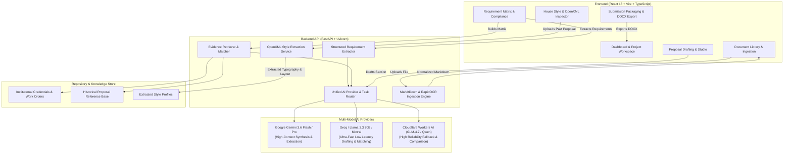

# AI Proposal & Tender Preparation Agent — Complete System Architecture & Operations Guide

---

## 1. Executive Overview

The **AI Proposal & Tender Preparation Agent** is an enterprise-grade AI system engineered specifically for professional service firms (such as **ACNABIN Chartered Accountants**). It transforms complex, lengthy Tender Documents, Requests for Proposals (RFPs), and Terms of Reference (ToRs) into fully compliant, impeccably formatted, evidence-backed technical and financial proposals.

### Primary Objectives
1. **High-Fidelity Document Ingestion**: Converts multi-format tender documents (scanned/digital PDFs, DOCX, XLSX, PPTX, images) into normalized Markdown using Microsoft MarkItDown with automatic OCR fallback.
2. **Deterministic Requirement Extraction**: Parses explicit tender requirements into structured Pydantic schemas, classifying requirements into 17 standardized categories with strict traceability.
3. **Evidence-Backed Matrix Matching**: Automatically queries institutional knowledge bases and firm credentials, grading evidence into 5 strictly controlled levels while enforcing anti-hallucination rules.
4. **House Style & Document Modeling**: Programmatically extracts OpenXML styles, typography, headers/footers, and section hierarchies from past winning proposals without manual templating.
5. **Context-Grounding Proposal Drafting**: Synthesizes custom proposal sections grounded solely in primary source evidence and tender specifications.
6. **Pre-Flight Compliance & Visual QA**: Audits drafts against all tender requirements and guarantees typographic/layout fidelity prior to DOCX export.

---

## 2. End-to-End System Architecture



---

## 3. Core Processing Pipeline

### Phase 1: Document Ingestion & Quality Analysis
1. **Multi-Format Processing**: The backend leverages `Microsoft MarkItDown` to parse `.pdf`, `.docx`, `.xlsx`, `.pptx`, `.txt`, and images.
2. **Automated OCR Fallback**:
   - If a PDF or image yields `< 150` characters or contains scanned bitmaps, the pipeline automatically routes it to `RapidOCR` + `pypdfium2`.
   - Generates structured markdown tables, headings, and clean text.
3. **Quality Metric Evaluation**: Evaluates character count, word density, heading ratio, table integrity, and OCR artifact scores (returning `good`, `acceptable`, or `poor`).

### Phase 2: OpenXML Style Extraction & House Style Modeling
Instead of relying on rigid, pre-made templates, the agent reverse-engineers Word document styles programmatically from sample `.docx` proposals:
- Inspects `word/document.xml`, `word/styles.xml`, `word/header*.xml`, and `word/footer*.xml`.
- Extracts:
  - Page dimensions and exact margin measurements (e.g. 0.75" / 1").
  - Primary, secondary, and accent heading colors (hex codes).
  - Body fonts, heading typography hierarchy (H1, H2, H3), line spacing, and paragraph margins.
  - Header/footer placement, logo coordinates, page numbering schemes, and confidentiality notices.
  - Section architecture, recurring boilerplate candidates, and client-restricted entities.

### Phase 3: Structured Requirement Extraction
- Input: Ingested tender markdown text.
- Task Router assigns **Google Gemini 3.6 Flash** (primary) and **Cloudflare GLM-4.7** (backup).
- Uses a strict zero-hallucination extraction prompt requiring valid JSON output conforming to the Pydantic schema:
  - `requirement_id`: Sequential identifier (`REQ-001`, `REQ-002`, ...).
  - `category`: Exactly one of 17 standard categories:
    - *Eligibility, Firm Experience, Engagement Partner Experience, Team Requirements, Technical Experience, Sector Experience, Financial Requirements, Legal / Regulatory, Methodology, Deliverables, Timeline, Reporting, Staffing, Logistics, Financial Proposal, Submission Requirements, Other.*
  - `mandatory`: Boolean based on mandatory keywords (`must`, `shall`, `mandatory`, `required`).
  - `evidence_required`: Boolean detecting mandatory proof documents (licenses, certificates, work orders, CVs).
  - `source_location`: Exact section, clause, or page number.
  - `status`: Defaulted to `identified`.
- If parsing fails, a single **controlled correction retry** is performed automatically.

### Phase 4: Evidence Retrieval & Requirement Matrix
- The agent queries the internal document repository (firm audit reports, trade licenses, partner CVs, completion certificates, and previous proposals).
- **5-Tier Controlled Evidence Statuses**:
  - `DIRECT_EVIDENCE`: Primary source document explicitly and directly satisfies all core conditions (e.g., valid ICAB certificate, work order $>=$ specified value).
  - `SUPPORTING_EVIDENCE`: Contextually supports the requirement but does not independently prove every threshold.
  - `REFERENCE_ONLY`: Sourced from a previous proposal without primary proof attached (see Safety Rule below).
  - `INSUFFICIENT`: Excerpt relates to the topic but clearly fails mandatory thresholds, dates, or criteria.
  - `NOT_FOUND`: No matching evidence discovered.
- **Previous Proposal Safety Rule**: Previous proposals are *never* classified as `DIRECT_EVIDENCE`. They are strictly classified as `REFERENCE_ONLY` or `INSUFFICIENT` to prevent compounding past proposal errors.

### Phase 5: Proposal Planning & Section Architecture
- Reconstructs the required proposal structure based on the tender's Terms of Reference and the firm's selected house style archetype (e.g., *Audit & Assurance, Advisory/Consulting, Taxation, Due Diligence*).
- Formulates a chapter-by-chapter outline with word-count targets, assigned methodology frameworks, and mapped matrix requirements.

### Phase 6: Grounded AI Drafting
- Assembles composite prompt context containing:
  1. Tender requirements mapped to that specific section.
  2. Verified evidence snippets from primary source documents.
  3. Extracted house style tone guidelines (formal, authoritative, first-person plural `"we/our"`).
  4. Explicit negative constraints (e.g., do not hallucinate team credentials or project fees not found in context).
- Routes generation across AI models depending on section type (e.g., Methodology drafting via Groq/Gemini, Technical Synthesis via Gemini).

### Phase 7: Compliance Audit & Pre-Flight QA
- Verifies that 100% of mandatory requirements (`mandatory == true`) have corresponding responses and attached direct/supporting evidence.
- Flags red-line compliance risks (e.g., missing tax clearance, expired audit partner license, unaddressed ToR deliverables).
- Runs visual layout validation to prevent orphaned headings, broken table boundaries, or style regressions before document compilation.

### Phase 8: Final Submission Package Assembly & DOCX Export
- Generates publication-ready Microsoft Word `.docx` documents matching the extracted house style OpenXML specification.
- Assembles submission checklists, mandatory forms, financial schedules, and appendix binders.

---

## 4. Multi-Model AI Routing & Fallback Matrix

The backend incorporates a dynamic **Task Router** that maps each specialized cognitive workflow to the optimal provider based on token window, reasoning capability, speed, and cost:

| AI Task Type | Primary Provider / Model | Backup Fallback Provider / Model | Rationale |
|---|---|---|---|
| **ToR Analysis** | `gemini` / `gemini-3.6-flash` | `cloudflare` / `@cf/zai-org/glm-4.7-flash` | Large context window for multi-page tender ingestion |
| **Requirement Extraction** | `gemini` / `gemini-3.6-flash` | `cloudflare` / `@cf/zai-org/glm-4.7-flash` | Strict adherence to complex JSON schemas & clauses |
| **Requirement Matrix** | `groq` / `openai/gpt-oss-120b` | `gemini` / `gemini-3.6-flash` | Rapid multi-candidate comparison and alignment |
| **Proposal Drafting** | `gemini` / `gemini-3.6-flash` | `groq` / `openai/gpt-oss-120b` | Long-form coherent generation with document grounding |
| **Methodology Drafting** | `groq` / `openai/gpt-oss-120b` | `gemini` / `gemini-3.6-flash` | High-speed technical structuring & flow |
| **Document Comparison** | `cloudflare` / `@cf/zai-org/glm-4.7-flash` | `groq` / `openai/gpt-oss-120b` | Cost-effective parallel text diff analysis |
| **Proofreading & QA** | `groq` / `openai/gpt-oss-120b` | `gemini` / `gemini-3.6-flash` | Ultra-low latency syntax and grammar verification |
| **Compliance Review** | `groq` / `openai/gpt-oss-120b` | `cloudflare` / `@cf/zai-org/glm-4.7-flash` | Fast pass/fail verification against audit checklists |
| **Document Synthesis** | `gemini` / `gemini-3.6-flash` | `cloudflare` / `@cf/zai-org/glm-4.7-flash` | Multi-source summarization & executive synthesis |
| **Evidence Matching** | `groq` / `openai/gpt-oss-120b` | `gemini` / `gemini-3.6-flash` | Fast classification across large evidence candidate sets |

### Automatic Fallback Mechanism
If the primary provider encounters a network timeout, rate limit (HTTP 429), or service outage, the `AiProviderService` automatically catches the exception and cascades to the secondary provider without exposing errors or credentials to the user.

---

## 5. Anti-Hallucination & Governance Protocols

1. **Strict Primary Sourcing**:
   - The agent is forbidden from assuming or inventing partner names, client references, audit completion values, or financial figures.
   - Any ungrounded claim triggers an `UNVERIFIED_CLAIM` flag in the pre-flight audit.
2. **Previous Proposal Safety Boundary**:
   - Statements found in previous proposals are treated as unverified historical text (`REFERENCE_ONLY`) unless backed by primary institutional artifacts (e.g. certificates, work orders, contracts).
3. **Deterministic Requirement Traceability**:
   - Every requirement in the matrix retains its original document filename and exact clause/page location.
4. **Controlled JSON Schema Enforcement**:
   - All AI interactions for requirement extraction and evidence evaluation are schema-constrained using Pydantic models.

---

## 6. Project Directory & Component Structure

```text
d:\Proposal Agent\
├── backend/                              # FastAPI Python Backend Service
│   ├── main.py                           # API entry point & CORS configuration
│   ├── requirements.txt                  # Python dependencies (FastAPI, MarkItDown, etc.)
│   ├── models/                           # Pydantic Schemas
│   │   ├── ai_models.py                  # AI request/response chat schemas
│   │   ├── document_models.py            # Document upload & inventory models
│   │   ├── evidence_models.py            # Evidence candidate & matrix schemas
│   │   └── requirement_models.py         # Extracted requirement models & enums
│   └── services/                         # Business Logic & Pipeline Services
│       ├── ai_provider.py                # Unified Multi-Provider Gateway (Groq, Gemini, CF)
│       ├── ai_task_router.py             # Centralized Task Routing & Fallback Config
│       ├── document_inventory_service.py # Test data & repository discovery
│       ├── document_processor.py         # MarkItDown engine + OCR fallback orchestration
│       ├── docx_style_extractor.py       # Programmatic OpenXML DOCX style extraction
│       ├── evidence_matcher.py           # AI-powered evidence evaluation against matrix
│       ├── evidence_retriever.py         # BM25/keyword retrieval from knowledge base
│       ├── extraction_quality.py         # Heuristic extraction quality checker
│       ├── file_validator.py             # Upload MIME & size validation
│       ├── ocr_engine.py                 # RapidOCR + pypdfium2 engine
│       ├── ocr_provider.py               # OCR provider abstraction
│       └── requirement_extractor.py      # Schema-enforced requirement extractor
│
├── src/                                  # React 18 + TypeScript Frontend
│   ├── App.tsx                           # Main application layout, routing & tabs
│   ├── components/                       # Modular UI Components
│   │   ├── compliance/                   # Compliance audit matrix & checklist view
│   │   ├── dashboard/                    # Overview stats, pipeline status & quick actions
│   │   ├── documents/                    # File upload, viewer, and document library
│   │   ├── financial/                    # Fee calculators & financial proposal tables
│   │   ├── forms/                        # Standard procurement submission forms
│   │   ├── knowledge/                    # Credentials, firm profiles & past proposals
│   │   ├── layout/                       # Header, Sidebar, Navigation, Notification UI
│   │   ├── matching/                     # Evidence matching workbench
│   │   ├── pptx/                         # Pitch deck presentation viewer & builder
│   │   ├── projects/                     # Tender project lifecycle manager
│   │   ├── proposals/                    # Section-by-section draft editor & review
│   │   ├── requirements/                 # Requirement Matrix table & filters
│   │   ├── submission/                   # Packaging, compliance binder & export UI
│   │   └── workspace/                    # Live drafting studio & split-screen reader
│   ├── pages/                            # Top-level Page Views
│   │   ├── DashboardPage.tsx             # Primary dashboard
│   │   ├── DocumentLibraryPage.tsx       # Repository & ingestion workspace
│   │   ├── ProjectsPage.tsx              # Tender pipeline & active bids
│   │   └── SettingsPage.tsx              # AI model configurations & API keys
│   └── services/                         # Client-Side Business Services
│       ├── aiService.ts                  # Client connector to backend AI endpoints
│       ├── docxGenerationService.ts      # Client-side DOCX generator using docx.js
│       ├── docxVisualQaService.ts        # Layout and typographic sanity checker
│       ├── evidenceMatchingService.ts    # Client matrix synchronization
│       ├── houseStyleService.ts          # Style profile management
│       ├── proposalDraftingService.ts    # Section-level prompt composition & drafting
│       ├── proposalPlannerService.ts     # Outline & architecture planner
│       └── torAnalysisService.ts         # Tender document ToR decomposition
│
├── test_data/                            # Reference documents, RFPs, credentials
├── output/                               # Generated proposals, matrices, exports
├── package.json                          # Vite/React frontend configuration
├── start.bat                             # One-click startup script (Backend + Frontend)
└── .env                                  # Environment variables & API credentials
```

---

## 7. Backend API Specification

| Method | Endpoint | Description | Request / Response Payload |
|---|---|---|---|
| `GET` | `/` | Root API documentation and health status | Returns API version and available endpoint URLs |
| `GET` | `/health` | Service and MarkItDown engine readiness | `{ "status": "ok", "markitdown": true }` |
| `GET` | `/api/ai/health` | Status of configured AI provider API keys | `{ "groq": true, "cloudflare": true, "gemini": true }` |
| `POST` | `/process-document` | Multipart file ingestion via MarkItDown + OCR | Uploads binary file; returns normalized markdown & quality metrics |
| `POST` | `/analyze-reference-docx` | OpenXML Style Extractor for past proposal | Uploads `.docx`; returns typography, colors, sections, boilerplate |
| `POST` | `/api/ai/chat` | Unified AI chat router | Accepts `{ provider, messages, model, temperature }` |
| `POST` | `/api/ai/extract-requirements` | Structured Tender Requirement Extractor | Accepts `{ document_name, document_type, content }`; returns structured requirement list |
| `GET` | `/api/documents/inventory` | Ingested repository document catalog | Categorizes documents by `required_document` vs `previous_proposal` |
| `POST` | `/api/ai/build-requirement-matrix` | Evidence Retrieval and Matrix Builder | Accepts requirements array; returns 5-tier matched matrix |

---

## 8. Setup & Execution Guide

### Prerequisites
- **Python 3.10+** (with `pip` and virtual environment support)
- **Node.js 18+** (with `npm`)

### Environment Variables (`.env`)
Configure the following API keys in the `.env` file located in the root workspace:
```ini
# Google Gemini API
GEMINI_API_KEY=your_gemini_api_key_here

# Groq Cloud API
GROQ_API_KEY=your_groq_api_key_here

# Cloudflare Workers AI
CLOUDFLARE_ACCOUNT_ID=your_cloudflare_account_id
CLOUDFLARE_API_TOKEN=your_cloudflare_api_token

# Application Ports
PORT=5173
BACKEND_PORT=8000
```

### Launching the Application
Execute the bundled `start.bat` script or run both services manually:

```powershell
# 1. Start Python FastAPI Backend
cd "d:\Proposal Agent"
python -m uvicorn backend.main:app --host 127.0.0.1 --port 8000 --reload

# 2. Start Vite Frontend (in a separate terminal)
cd "d:\Proposal Agent"
npm run dev
```

The web application will be accessible at: `http://localhost:5173`
The backend Swagger interactive API docs will be at: `http://127.0.0.1:8000/docs`
